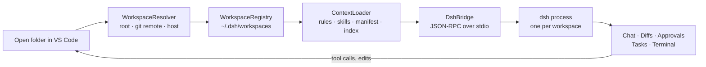

# DSH for VS Code

**DeepSeek Harness inside VS Code — agent sessions that follow the folder you open.**

> Status: **idea / pre-alpha**. This repository currently contains the project specification and design notes, not a working extension.

---

## The idea

DSH ([DeepSeek Harness](https://github.com/VictorKozachek)) is an agentic harness with sessions, skills, project rules (`AGENTS.md`), sandbox policies and multi-agent orchestration. Today it lives in a terminal or a browser tab — outside the editor. The agent doesn't know which project is open, what file you're looking at, or which diagnostics just appeared.

This project brings the full harness into VS Code:

- **Workspace-aware by design.** The extension sees which folder is open, resolves the project root, and knows exactly whose context it should use.
- **Context on open.** `AGENTS.md`, skills, manifests and the file index are loaded automatically when you open a folder — no manual setup.
- **Sessions that remember.** Switch folders and the agent switches context with you; come back and the conversation continues where it stopped.
- **Native feel.** Inline approvals, diff previews before edits, terminal and diagnostics integration, status bar with the active workspace and sandbox mode.

## How it works



Each workspace gets its own DSH process and session store. Switching folders pauses the current session (with a grace period for quick switches) and loads the new project's context; nothing from the previous project leaks into the conversation.

## Feature sketch

| Area | What you get |
|---|---|
| Workspace detection | Root resolution, `git remote` identity, multi-root and remote (SSH/WSL/Codespaces) support |
| Context | `AGENTS.md` rules, skills, `.dsh/workspace.json` manifest, file index with caching and hot reload |
| Sessions | Create, resume, pause, restore after IDE restart |
| Panel | Sessions, kanban task board, context inspector, chat with tool-call blocks |
| Safety | Sandbox modes, approval policies, diff preview, audit log, secret filtering |

## Roadmap

- **M0** — extension scaffold, workspace resolver and registry, status bar, RPC skeleton.
- **M1** — streaming chat, tool calls, approvals, context loader, file edits with undo.
- **M2** — seamless folder switching, multi-root, remote hosts, context inspector.
- **M3** — task board, sub-agent visualization, terminal bridge, VSIX packaging.

## Repository layout

```
extension/        VS Code extension (TypeScript)
webview/          Panel UI (React + Vite)
protocol/         JSON-RPC schema and shared types
docs/             Architecture notes and ADRs
tests/            Unit and integration tests
SPECIFICATION.md  Full project specification (Russian)
```

## Documentation

- [SPECIFICATION.md](SPECIFICATION.md) — full project specification: architecture, workspace model, panel design, milestones (in Russian).
- [README.ru.md](README.ru.md) — the same introduction in Russian.

## Contributing

The project is at the idea stage: discussions, specification feedback and design proposals are welcome via issues. Implementation will follow the milestones above.

## License

Not decided yet — will be published before the first public release.
