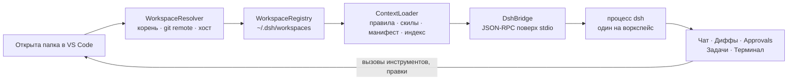

# DSH for VS Code

**DeepSeek Harness внутри VS Code — агентские сессии, которые следуют за открытой папкой.**

> Статус: **идея / pre-alpha**. В репозитории пока только спецификация и заметки о дизайне, работающего расширения ещё нет.

---

## Идея

DSH ([DeepSeek Harness](https://github.com/VictorKozachek)) — агентный харнесс с сессиями, скилами, правилами проекта (`AGENTS.md`), sandbox-политиками и оркестрацией субагентов. Сегодня он живёт в терминале или во вкладке браузера — вне редактора. Агент не знает, какой проект открыт, какой файл вы смотрите и какие ошибки только что появились в диагностике.

Этот проект переносит полный функционал харнеса в VS Code:

- **Воркспейс определяется сам.** Расширение видит открытую папку, определяет корень проекта и точно знает, чей контекст использовать.
- **Контекст поднимается при открытии.** `AGENTS.md`, скилы, манифест и индекс файлов загружаются автоматически при открытии папки — без ручной настройки.
- **Сессии помнят.** Переключили папку — агент переключил контекст вместе с вами; вернулись — разговор продолжается с того места, где остановился.
- **Нативно для IDE.** Инлайн-подтверждения, дифф до применения правок, интеграция с терминалом и диагностикой, статус-бар с активным воркспейсом и режимом sandbox.

## Как это работает



У каждого воркспейса свой процесс DSH и своё хранилище сессий. Смена папки ставит текущую сессию на паузу (с grace period для быстрых переключений) и загружает контекст нового проекта — ничего из прошлого проекта в разговор не протекает.

## Что примерно будет

| Область | Что получаете |
|---|---|
| Определение воркспейса | Корень, идентичность по `git remote`, multi-root, remote (SSH/WSL/Codespaces) |
| Контекст | Правила `AGENTS.md`, скилы, манифест `.dsh/workspace.json`, индекс файлов с кэшем и hot reload |
| Сессии | Создание, возобновление, пауза, восстановление после рестарта IDE |
| Панель | Сессии, kanban-доска задач, инспектор контекста, чат с блоками tool-call |
| Безопасность | Sandbox-режимы, политики подтверждений, дифф-предпросмотр, аудит, фильтрация секретов |

## План

- **M0** — каркас расширения, resolver и реестр воркспейсов, статус-бар, скелет RPC.
- **M1** — потоковый чат, вызовы инструментов, approvals, загрузчик контекста, правки файлов с undo.
- **M2** — бесшовное переключение папок, multi-root, remote-хосты, инспектор контекста.
- **M3** — доска задач, визуализация субагентов, терминал-мост, сборка VSIX.

## Структура репозитория

```
extension/        расширение VS Code (TypeScript)
webview/          UI панели (React + Vite)
protocol/         JSON-RPC-схема и общие типы
docs/             архитектурные заметки и ADR
tests/            unit- и интеграционные тесты
SPECIFICATION.md  полная спецификация проекта (русский)
```

## Документация

- [SPECIFICATION.md](SPECIFICATION.md) — полная спецификация: архитектура, модель воркспейса, дизайн панели, этапы.
- [README.md](README.md) — то же введение на английском.

## Участие

Проект на стадии идеи: обсуждения, замечания к спецификации и предложения по дизайну — через issues. Реализация пойдёт по этапам выше.

## Лицензия

Пока не определена — будет опубликована до первого публичного релиза.
